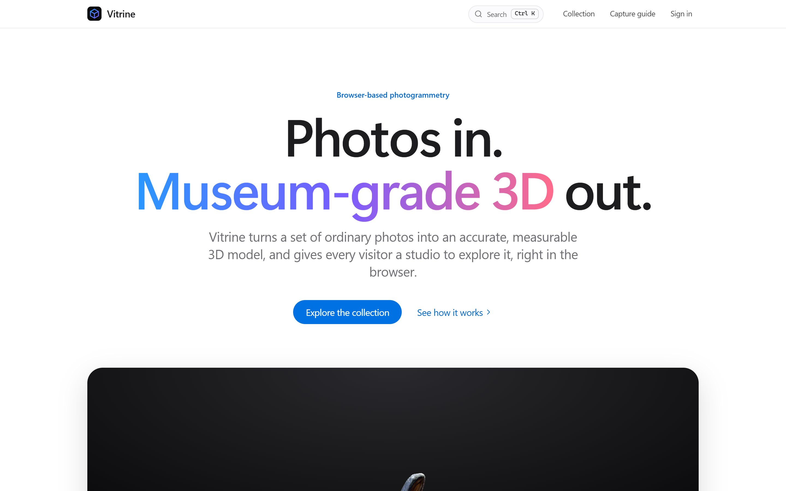
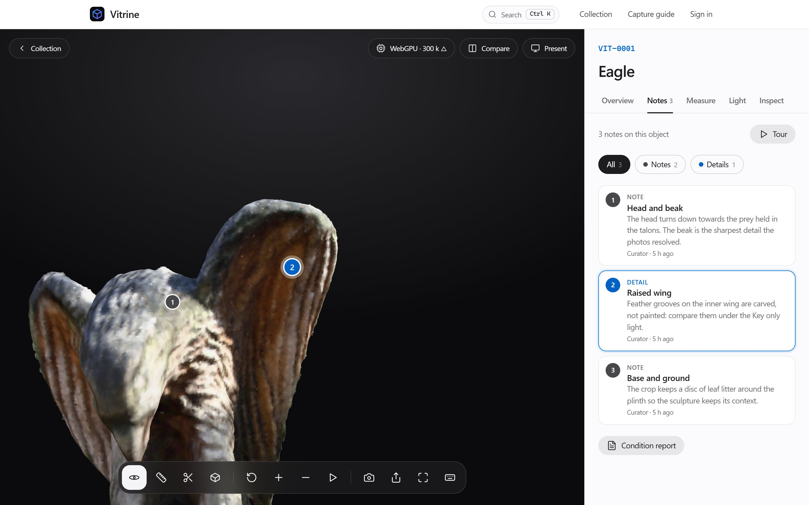
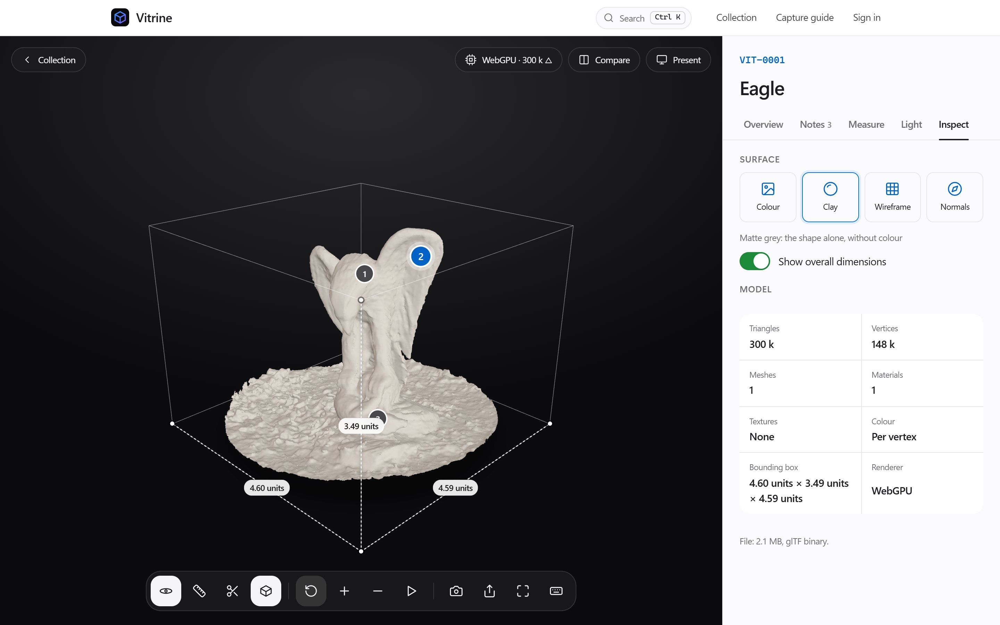
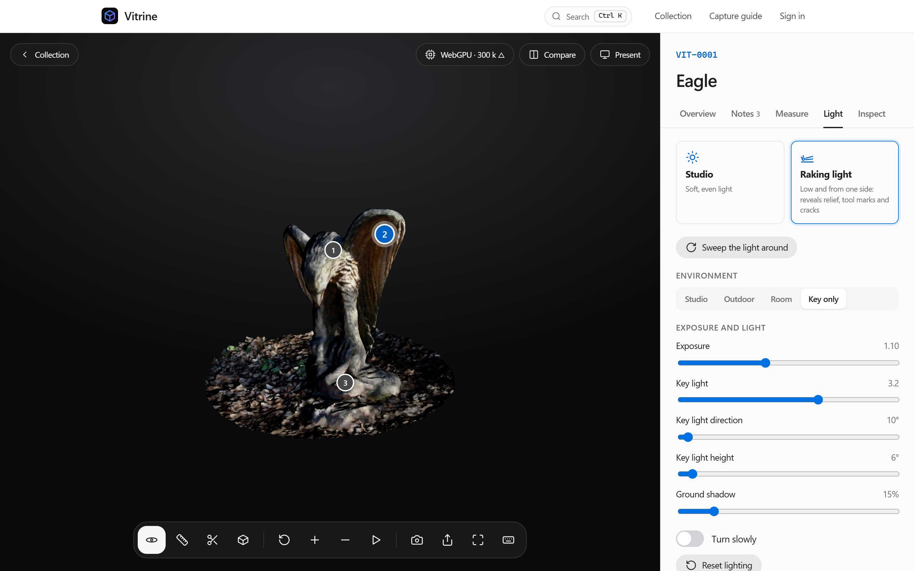
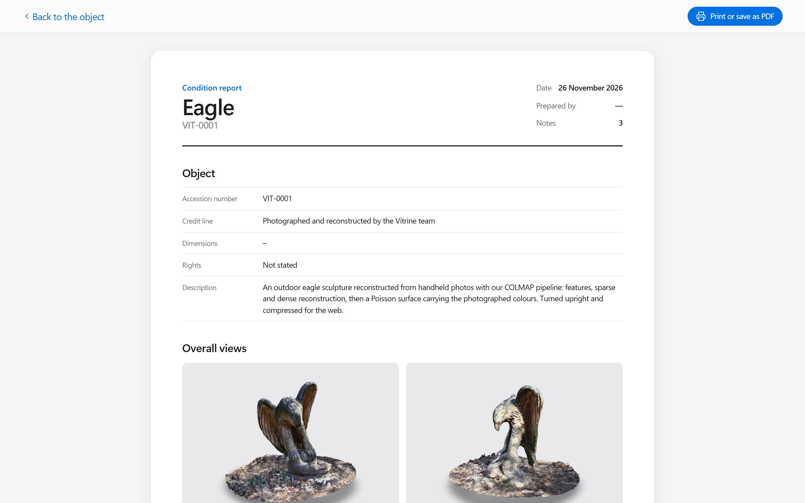
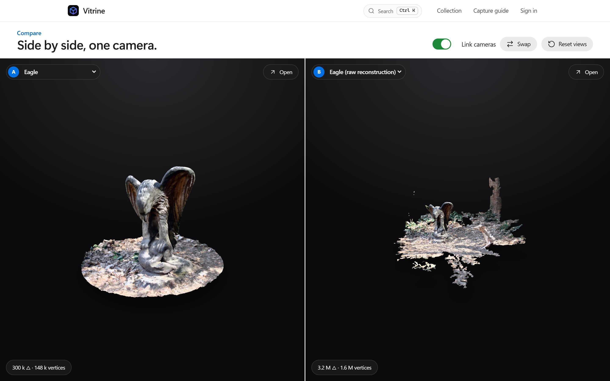
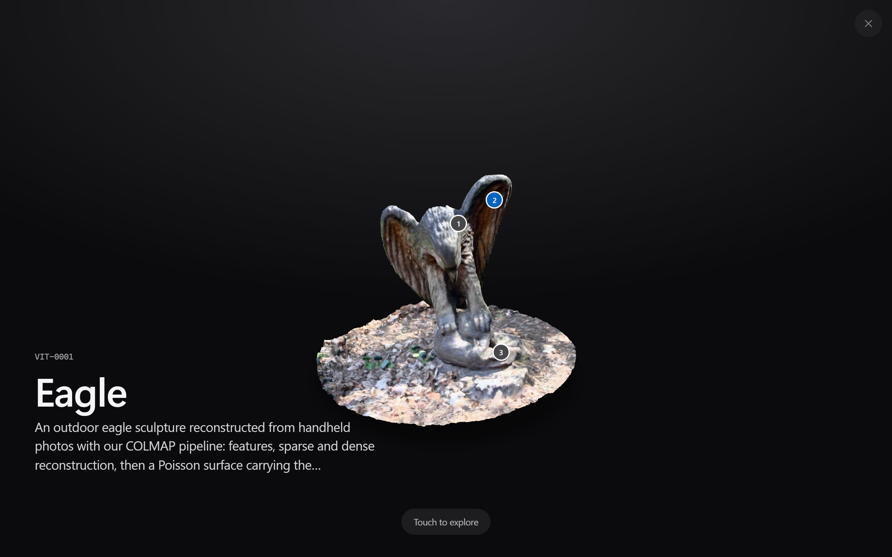
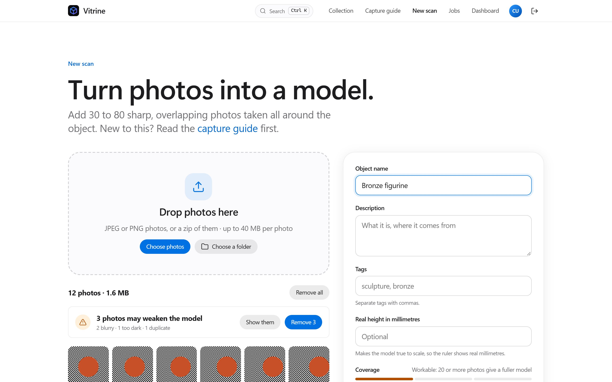
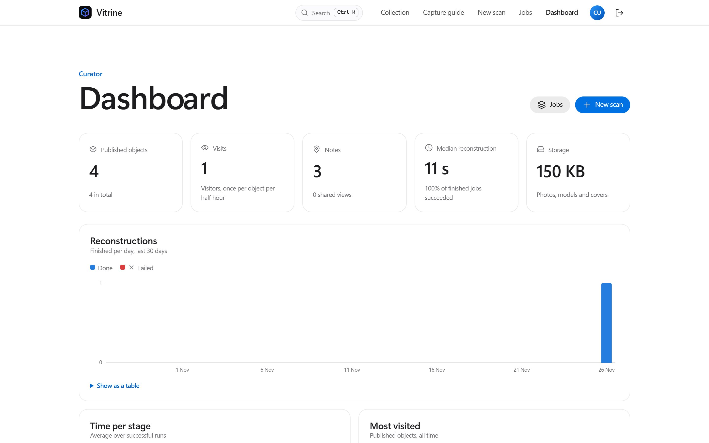
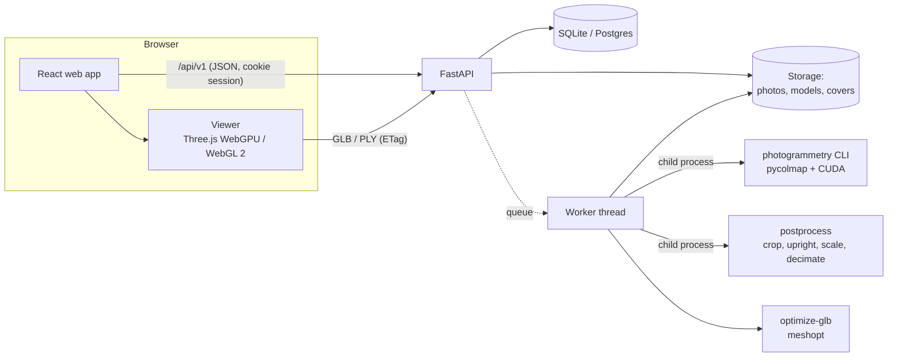

<div align="center">


# Vitrine

**Photos in. Museum‑grade 3D out.**

Browser-based photogrammetry and a professional 3D viewer: upload a set of photos, get a clean,
measurable model, and let anyone turn, measure, annotate, relight and share it in the browser.

[](https://github.com/RafalLeja/Browser-Based-Photogrammetry-and-3D-Model-Viewer/actions/workflows/ci.yml)


[Features](#features) · [Quick start](#quick-start) · [Architecture](#architecture) · [Testing](#testing) · [Deployment](#deployment) · [Docs](#documentation)



</div>

---

## Why Vitrine

Collections hold millions of objects that people can only see behind glass. Photogrammetry can
turn ordinary photos into accurate 3D records, but it usually takes desktop software, a GPU
workstation, a specialist and a separate publishing platform. Vitrine puts the whole chain in
one product: **capture guidance → reconstruction → clean-up → publishing → an interactive viewer
that runs in any modern browser**.

| | |
|---|---|
| **97.6 % smaller models** | The showcase scan went from 3.2 M triangles / 90.7 MB to 300 k triangles / 2.2 MB after cropping, clean-up and meshopt compression. |
| **60 fps** | The full 3.2 M-triangle raw scan orbits at 60 fps on WebGPU and on the WebGL 2 fallback (desktop GPU, W03 test). |
| **Zero installs** | Visitors need only a browser; curators upload photos from a web page. |

## Features

<table>
<tr>
<td width="50%"></td>
<td width="50%"></td>
</tr>
<tr>
<td><b>Notes on the surface.</b> Pins by category (note, detail, inscription, damage with a severity, repair) fly the camera to each note; a guided tour plays them in order.</td>
<td><b>Inspect the shape.</b> Colour, clay, wireframe and normals views, overall dimensions on the bounding box, and model statistics.</td>
</tr>
<tr>
<td width="50%"></td>
<td width="50%"></td>
</tr>
<tr>
<td><b>Raking light.</b> A low light from one side, as conservators use it, sweeps around the object to reveal relief, tool marks and cracks.</td>
<td><b>Condition reports.</b> Four overall views and a close-up of every note, damage first by severity, ready to print or save as PDF.</td>
</tr>
<tr>
<td width="50%"></td>
<td width="50%"></td>
</tr>
<tr>
<td><b>Compare.</b> Two objects side by side; turn one and the other follows at the same angle and relative zoom.</td>
<td><b>Kiosk mode.</b> An attract loop for a gallery screen that tours each object's notes and hands control to a visitor on touch.</td>
</tr>
<tr>
<td width="50%"></td>
<td width="50%"></td>
</tr>
<tr>
<td><b>Every photo checked.</b> Blur, exposure, duplicates and resolution are checked in the browser before anything is uploaded.</td>
<td><b>Curator dashboard.</b> Objects, visits, notes, reconstruction times and storage, with charts and table views.</td>
</tr>
</table>

**Viewer** · WebGPU with automatic WebGL 2 fallback · GLB/glTF and PLY · Draco, meshopt and KTX2
decoding · ruler with undo · categorised annotation pins with occlusion dimming · camera flights
and guided tour · section plane · colour, clay, wireframe and normals render modes · labelled
overall dimensions · studio, outdoor, room and raking light with exposure and a movable key light
· subject-cropped covers and screenshots · STL and OBJ export · shareable views and iframe embeds
that share scrolling with the host page · linked cameras for comparison · render on demand ·
keyboard shortcuts (<kbd>M</kbd> measure, <kbd>N</kbd> note, <kbd>S</kbd> section, <kbd>D</kbd>
dimensions, <kbd>1</kbd>–<kbd>4</kbd> render modes, <kbd>R</kbd> reset, <kbd>F</kbd> full screen,
<kbd>?</kbd> all shortcuts).

**Web app** · landing page · collection with search (title, accession number, maker, material),
tag filters, sorting, licence badges and pagination · object page with Overview, Notes, Measure,
Light and Inspect panels · museum record (accession number, maker, date, place, material, credit
line, provenance) · Creative Commons licences, downloads and a citation in text and BibTeX · text
descriptions for screen readers · condition notes and printable reports · compare · kiosk mode ·
curator dashboard · <kbd>Ctrl</kbd>/<kbd>⌘</kbd>+<kbd>K</kbd> command palette · upload with an
in-browser photo check · job timeline · capture guide · light and dark themes · phone layouts ·
keyboard and screen-reader support · reduced-motion support.

**API** · FastAPI · session login with Argon2id and HttpOnly cookies · curator role · uploads
checked by content with zip-slip and zip-bomb protection · background job queue with retry,
cancel, logs and stage timings · museum record, licence and accessibility fields · condition
notes with categories and severities · licence-aware downloads · visit counting · dashboard
statistics · shared views · thumbnails · ETag caching · rate limits · security headers · additive
schema upgrades on start · SQLite for development, Postgres in production.

**Pipeline** · COLMAP feature extraction, matching, sparse and dense reconstruction and Poisson
meshing (pycolmap, CUDA) · post-processing that turns the scan upright from the camera poses,
crops it around the cameras' target, removes floating fragments, scales it from a known height,
decimates it and writes a GLB · meshopt compression · workspaces removed after a successful run.

## Quick start

**Requirements:** [uv](https://docs.astral.sh/uv/) (installs Python 3.14 for you), Node.js 22.18+
and Git LFS. Reconstruction needs an NVIDIA GPU with CUDA; without one the API runs a clearly
labelled **demo pipeline** that walks through every stage and publishes a sample scan, so the
whole product can be tried on any laptop.

```bash
git lfs install && git clone https://github.com/RafalLeja/Browser-Based-Photogrammetry-and-3D-Model-Viewer.git
cd Browser-Based-Photogrammetry-and-3D-Model-Viewer

# 1. API (terminal 1)
cd backend
cp .env.example .env            # set CURATOR_PASSWORD
uv sync
uv run uvicorn app.main:app --reload --reload-dir app     # http://127.0.0.1:8000/api/docs

# 2. Web app (terminal 2)
cd viewer
npm ci
npm run dev                     # http://localhost:5173
```

Sign in with the curator account from `backend/.env`, open **New scan**, and upload photos.
The collection starts with three showcase objects from `samples/`.

## Architecture



| Folder | What lives there | Owner |
|---|---|---|
| [`viewer/`](viewer) | Web app (React + Vite) and the viewer library (`src/viewer.ts`, public API in `src/types.ts`) | Ali, Hanna |
| [`backend/`](backend) | FastAPI service, database models, job worker | Wojciech |
| [`photogrammetry-lib/`](photogrammetry-lib) | COLMAP pipeline and mesh post-processing | Rafał |
| [`samples/`](samples) | Showcase models and covers (Git LFS) | Team |
| [`docs/`](docs) | Product plan, architecture, API, security, evaluation | Team |

More detail: [docs/architecture.md](docs/architecture.md).

## Testing

| Suite | Command | What it covers |
|---|---|---|
| API | `cd backend && uv run pytest` | 41 tests: auth, roles, rate limits, upload validation and zip slip, job lifecycle and clean-up, search, museum record and licences, downloads, condition notes, visits, dashboard statistics, schema upgrades, shared views, caching, cross-site protection |
| Pipeline | `cd photogrammetry-lib && uv run pytest` | 35 tests: storage hashing, orientation from cameras, crop, fragments, scale, decimation, normals, GLB writer, PLY reader, CLI |
| Viewer and web app | `cd viewer && npm test` | 62 unit tests: loading, framing, ruler maths, sections, dimensions, subject crops, linked cameras, model statistics, photo quality, citations, report order, light restore, formatting, job states |
| End to end | `cd viewer && npm run e2e` | 23 browser tests against the real API and web app: browse, measure, share, sign-in rules, upload → job → annotate → edit → delete, inspect, raking light, museum record and citation, condition report, compare, kiosk, dashboard, command palette, photo check, scrolling over the 3D hero, phone layouts |
| Types and build | `cd viewer && npm run check` | TypeScript for app, tests and e2e, then a production build |

CI runs all of them on every pull request ([`.github/workflows/ci.yml`](.github/workflows/ci.yml)).
The e2e suite uses an installed Edge or Chrome locally (`PW_CHANNEL` to choose) and Playwright's
Chromium in CI.

## Deployment

```bash
CURATOR_PASSWORD='choose-a-strong-one' docker compose up --build     # http://localhost:8080
```

Three containers: Postgres, the API with its worker, and nginx serving the web app and proxying
`/api`. The API image has no CUDA, so it runs the demo pipeline; see
[docs/deployment.md](docs/deployment.md) for GPU reconstruction, HTTPS and backups.

## Documentation

- [Product and design plan](docs/product/design-plan.md): personas, UX research, product comparisons, museum workflows, roadmap, pitch
- [Architecture](docs/architecture.md): components, data model, job flow
- [REST API](docs/api.md) (live docs at `/api/docs` when the API runs)
- [Viewer API](viewer/README.md)
- [Security](SECURITY.md)
- [Deployment](docs/deployment.md)
- [Contributing](CONTRIBUTING.md)

## Team

Built at Wrocław University of Science and Technology for *Multimedia and Computer Visualization*.

| Member | Area |
|---|---|
| Rafał | Photogrammetry pipeline |
| Wojciech | Backend and API |
| Hanna | Frontend and UX |
| Ali | 3D viewer |

The *Damaged Helmet* sample is © 2018 ctxwing (CC BY 4.0), based on a model © 2016 theblueturtle_ (CC BY-NC 4.0), from the Khronos glTF sample assets.
The studio HDR is from Poly Haven (CC0).
