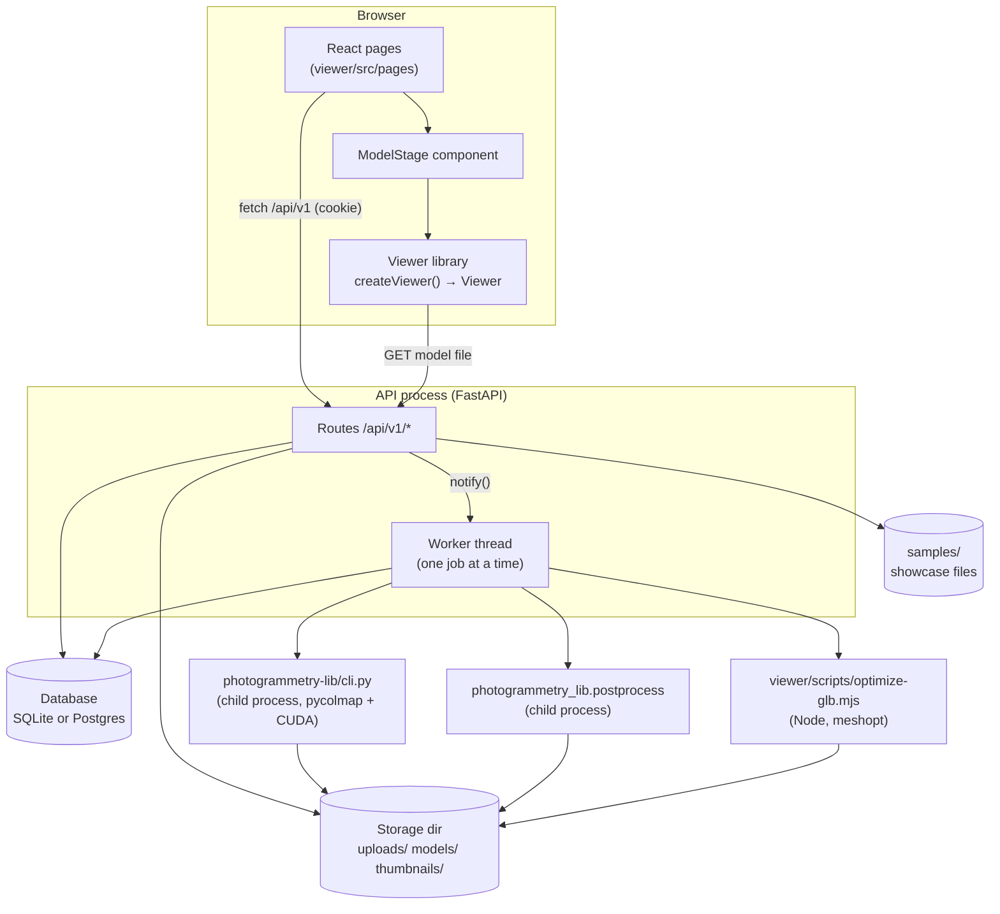
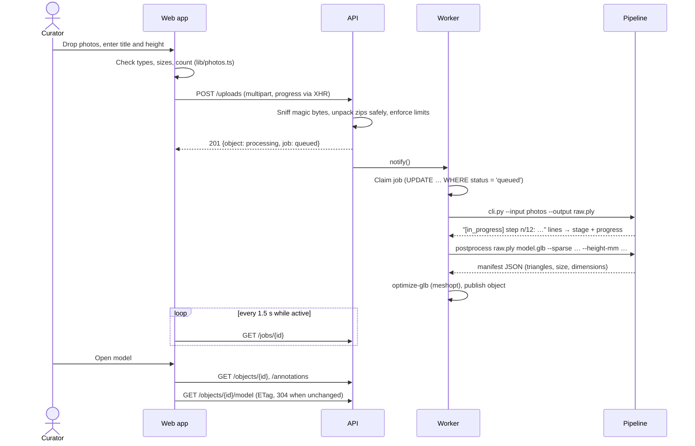
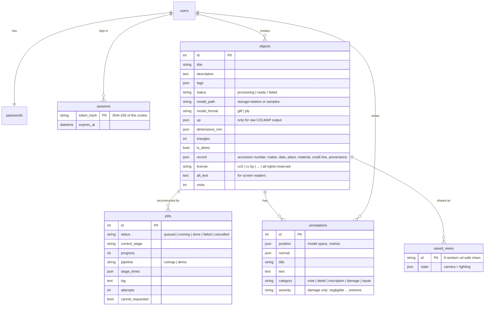

# Architecture

Vitrine has three parts that ship together: a **web app** with an embedded **viewer** library,
an **API** with a background **worker**, and the **photogrammetry pipeline**.

## Request and job flow

Without a CUDA GPU the worker runs `run_demo` instead of `run_colmap`: the same stages with short
pauses, then the sample scan is published with `is_demo = true`, which the UI labels everywhere.

## Data model

## Viewer internals

- `viewer.ts` owns the renderer, camera, controls, lights, environment and the loaded model.
  It renders **only when something changed** (camera moved, damping, a flight, a tool update).
- `overlay.ts` draws pins, ruler lines and labels as HTML/SVG over the canvas, so they stay crisp
  and pins are real, focusable buttons.
- Raycasts use a bounding-volume tree (`three-mesh-bvh`), built once per model when a tool is
  first used, so clicks and pin occlusion checks stay fast on million-triangle scans.
- Pins and measurements are stored in **model space**; the viewer converts to world space for
  display, so turning a raw scan upright never moves a note off its spot.
- The section plane uses three's `ClippingGroup`, which works on both WebGPU and WebGL 2.
- `environments.ts` generates the studio and outdoor lighting from tiny scenes baked with PMREM,
  so they need no download.
- Render modes swap each mesh's material for a shared clay or normal material, and keep the
  model's own materials to put back; wireframe adds helper meshes that share the geometry and are
  skipped by picking, statistics and export.
- `camera-move` fires on every frame the camera moves; the compare page mirrors it into the other
  viewer with `mirrorView`, which keeps the angle and the zoom relative to each model's size.
- `screenshot({ fit: 'subject' })` crops to the model's projected bounding box, for covers and
  report images; `exportModel()` writes STL or OBJ from a shallow clone turned to Z up.

## Schema upgrades

`create_all` makes missing tables; `app/database/migrate.py` then adds columns that newer models
have and an older database lacks (nullable, or with a server default). Anything beyond additive
changes needs Alembic.

## Decisions

| Decision | Why | Revisit when |
|---|---|---|
| One FastAPI service with an in-process worker thread | One process to run and test; the worker still runs COLMAP in a child process, so a native crash cannot kill the API | Several GPUs or API replicas: move the queue to Redis/RQ (`EMBEDDED_WORKER=false` already disables the thread) |
| Session cookie instead of JWT | Revocable on logout, HttpOnly so scripts cannot read it, no token storage in the browser | A public API for third parties |
| `create_all` instead of migrations | The schema is still changing weekly | Before the first production deployment with real data: add Alembic |
| Vertex colours, not textures | Comes straight from COLMAP's Poisson mesh; meshopt compresses it well | Texturing (OpenMVS or Blender bake) is on the roadmap |
| Same-origin `/api` (Vite proxy, nginx) | Cookies work without cross-site settings; no CORS in production | Never, for the web app |
