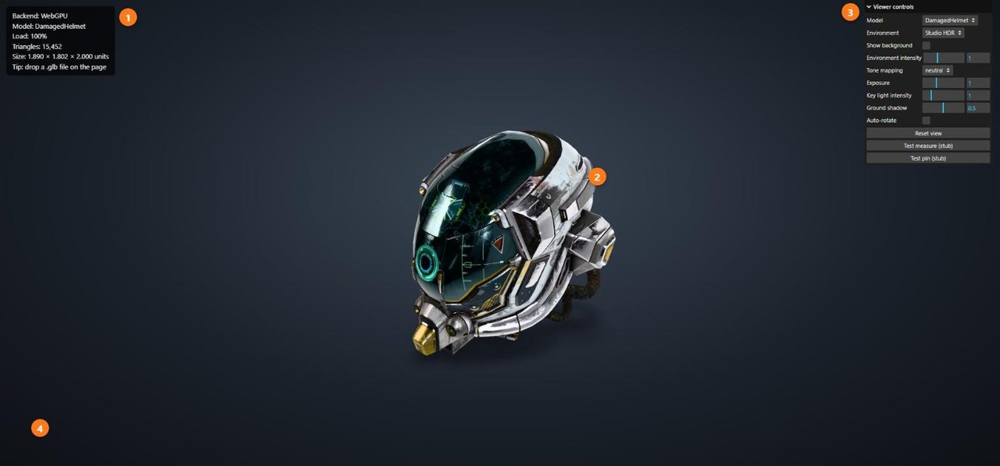
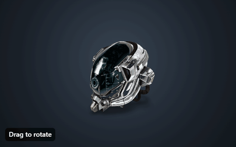
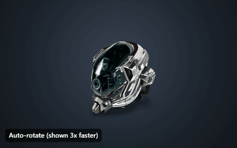
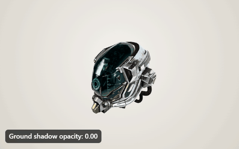
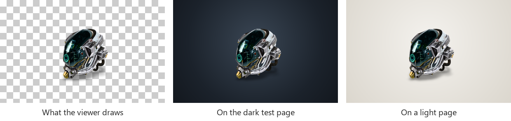
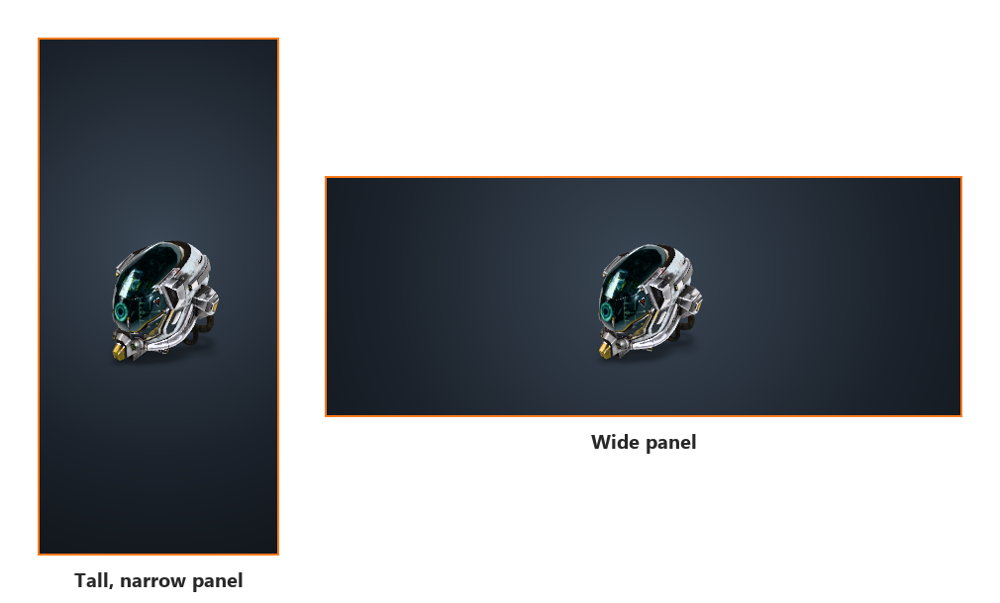
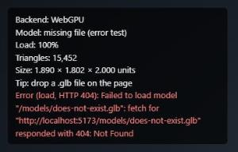
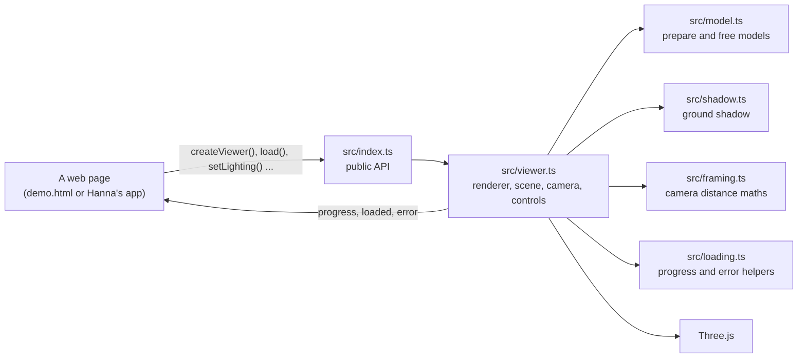
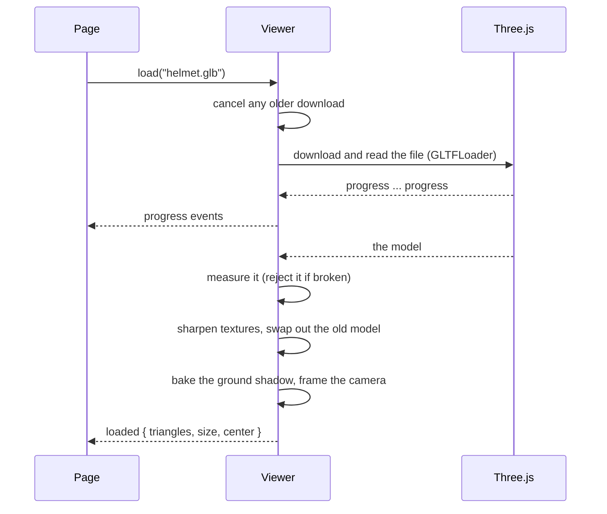

# Viewer walkthrough: start here

A guided tour of the 3D model viewer for someone new to the project, Three.js or 3D on the web. It shows what the viewer does today, how to run it, and where to look in the code.

**Current state:** end of week 2 (W02), 12 Nov 2026. This page is updated every week, so the pictures always show the current version.



## Contents

1. [What this is](#1-what-this-is)
2. [Progress by week](#2-progress-by-week)
3. [Run it in five minutes](#3-run-it-in-five-minutes)
4. [A tour of the test page](#4-a-tour-of-the-test-page)
5. [Things to try](#5-things-to-try)
6. [How it works](#6-how-it-works)
7. [Reading the code](#7-reading-the-code)
8. [Tests and checks](#8-tests-and-checks)
9. [Glossary](#9-glossary)
10. [Where to go next](#10-where-to-go-next)

## 1. What this is

Our project turns photos of an object into a 3D model (photogrammetry). This part, the **viewer**, shows that model in a web browser: you can turn it, zoom in, change the lighting and, in later weeks, measure it and pin notes to it.

- It is written in **TypeScript** and uses **Three.js**, the most widely used 3D library for the web.
- It draws with **WebGPU**, the newest browser graphics API, and falls back to **WebGL 2** on browsers without it.
- The website (Hanna's frontend) uses it through a small, documented API, so the website never needs to know Three.js.

## 2. Progress by week

| Week | What was added | Details |
|---|---|---|
| W01, 2–8 Nov | Load a `.glb` model with progress and errors, orbit camera with smooth motion, realistic (PBR) lighting, HDR environments, WebGPU with WebGL 2 fallback | [W01 notes](w01-three-study.md) |
| **W02, 9–15 Nov** | A newer load cancels the older one, error codes, camera that fits any panel shape, reset view, auto-rotate, transparent canvas, soft ground shadow, drag and drop, unit tests, CI, integration guide | [W02 notes](w02-notes.md), [changelog](../../viewer/CHANGELOG.md) |
| Planned | Measuring ruler (W04), annotation pins (W05), compressed models and more lighting presets (W06), performance work (W07), saved views (W08) | [README](../../viewer/README.md#api-reference) |

## 3. Run it in five minutes

**You need:**

- [Node.js](https://nodejs.org/) 22.18 or newer. Check with `node --version`.
- Git, and a recent Chrome, Edge or Brave. Firefox and Safari are not tested yet.

**Steps** (PowerShell or any terminal):

```powershell
git clone https://github.com/RafalLeja/Browser-Based-Photogrammetry-and-3D-Model-Viewer.git
cd Browser-Based-Photogrammetry-and-3D-Model-Viewer
git checkout Ali
cd viewer
npm ci          # installs the exact package versions from package-lock.json
npm run dev     # starts a local web server
```

The terminal prints a local address. Open **http://localhost:5173/demo.html**. You should see the helmet from the picture at the top of this page within a second or two.

**If something goes wrong:**

| What you see | What to do |
|---|---|
| `npm ci` complains about the Node version | Install Node 22.18 or newer, then run `npm ci` again |
| The terminal shows port 5174 instead of 5173 | Something else uses 5173. Use the address the terminal prints |
| The panel says `Backend: WebGL 2` | Your browser has no WebGPU. Everything still works |
| The model menu offers "eagle (raw scan)" but it fails | That file is not committed. See the [README](../../viewer/README.md#run-it) for the copy command |
| A blank page | Press F12 and read the Console tab. The viewer's own warnings start with `[viewer]` |

## 4. A tour of the test page

The test page (`viewer/demo.html`) is not the real website. It is a workbench that exposes every viewer feature through a control panel, so each one can be tried in isolation.

The numbers match the labels in the screenshot at the top of this page.

1. **Status panel.** Which graphics backend is active, the loaded model's name, download progress, triangle count and size. Errors appear here in red.
2. **The model.** Drag to turn it, scroll to zoom, right-drag to move it sideways.
3. **Control panel.** Model, environment, lighting, shadow, auto-rotate and reset view. It is built with the small [lil-gui](https://lil-gui.georgealways.com/) library.
4. **The backdrop.** A CSS gradient on the page itself. The viewer's canvas is see-through, so the page decides what shows behind the model.

## 5. Things to try

### Turn, zoom and reset the camera

Drag to rotate around the model, scroll to zoom, and press **Reset view** to get the starting view back. The wheel zooms towards the point under the mouse, and the camera cannot be panned so far that the model is lost.



### Auto-rotate

Tick **Auto-rotate**. The model turns once every 30 seconds and pauses while you drag. The speed is the same on a 60 Hz and a 120 Hz screen, because it depends on elapsed time, not on the number of frames.



### The ground shadow

Move the **Ground shadow** slider. The soft dark patch under the model makes it look like it rests on the ground. The shadow is computed once when the model loads, so it costs almost nothing while you turn the camera. The recording uses a light backdrop, where the shadow is easiest to see.



### The see-through canvas

The viewer draws only the model and its shadow; every other pixel is transparent. Left: what the viewer draws (the checkerboard means "transparent"). Middle and right: the same image on the dark test page and on a light page. Tick **Show background** to show the 360° studio photo behind the model instead.



### Any panel shape

The camera stands far enough back that the whole model fits, whatever the shape of the box it is placed in. A tall, narrow panel needs the camera further away than a wide one. When the panel is resized, the camera follows, until you move it yourself.



### What an error looks like

Pick **missing file (error test)** in the model menu. The red row names the kind of error (`load`) and the HTTP status (404 = not found). The helmet stays on screen, because a failed load never removes the current model.



### Your own model

Drag any `.glb` file from your computer onto the page. Its name appears in the status panel. Open the browser console (F12) to see warnings, for example about materials that ignore lighting.

### The fallback renderer

Add `?webgl` to the address: **http://localhost:5173/demo.html?webgl**. The status panel now says `Backend: WebGL 2`, and everything should look the same.

## 6. How it works

### The pieces



A page only ever talks to `src/index.ts`. Everything behind it can change without breaking the page. The viewer reports back through events: `progress` while downloading, `loaded` when the model is shown, `error` when something fails.

### What happens when you load a model



Every frame after that, about 60 times a second, the viewer updates the camera controls and draws the scene.

## 7. Reading the code

Read in this order; each file is short and commented for learners.

| # | File | What to look for |
|---|---|---|
| 1 | [`viewer/src/types.ts`](../../viewer/src/types.ts) | The whole API in one place: what a page can call and what it gets back |
| 2 | [`viewer/src/demo/main.ts`](../../viewer/src/demo/main.ts) | How a page uses the API: create, listen to events, load, wire controls |
| 3 | [`viewer/src/viewer.ts`](../../viewer/src/viewer.ts) | `createViewer()`, the constructor (renderer, camera, controls, resize), `load()`, `placeCamera()` |
| 4 | [`viewer/src/framing.ts`](../../viewer/src/framing.ts) | The right-triangle maths that decides how far back the camera stands |
| 5 | [`viewer/src/loading.ts`](../../viewer/src/loading.ts) | Honest progress numbers and telling a cancelled download from a failed one |
| 6 | [`viewer/src/model.ts`](../../viewer/src/model.ts) | Freeing GPU memory, counting triangles, catching broken models |
| 7 | [`viewer/src/shadow.ts`](../../viewer/src/shadow.ts) | The contact shadow: a hidden camera, an off-screen image and a blur |
| 8 | [`viewer/src/events.ts`](../../viewer/src/events.ts) | A tiny typed event emitter |
| 9 | [`viewer/test/`](../../viewer/test/) | Unit tests: each one names the behaviour it protects |

The [W01 notes](w01-three-study.md) explain the Three.js basics (scene, camera, renderer, PBR, HDR). The [W02 notes](w02-notes.md) explain this week's techniques in more depth.

## 8. Tests and checks

Run these inside `viewer/`:

```powershell
npm test          # unit tests
npm run check     # type-check, unit tests and production build: what CI runs
```

A good run of `npm test` ends like this:

```text
ℹ tests 22
ℹ pass 22
ℹ fail 0
```

- **Unit tests** cover the parts that need no graphics card: camera maths, progress and error rules, model helpers, events.
- **Browser checks** cover what needs a GPU: rendering, the shadow, the camera in real panels. They are listed with their results in section 12 of the [W02 notes](w02-notes.md#12-observations).
- **CI**: every pull request that touches `viewer/` runs `npm run check` on GitHub. The result appears in the pull request's Checks tab.

## 9. Glossary

| Term | Meaning |
|---|---|
| **GLB / glTF** | The standard file format for 3D models on the web. A `.glb` packs geometry, materials and textures into one file |
| **Mesh** | A 3D shape made of triangles, plus a material that says how its surface looks |
| **PBR** | Physically based rendering: materials described by real properties (colour, metalness, roughness), so they look right under any light |
| **HDR environment** | A 360° photo with real brightness values. It lights the model from every direction and gives metal something to reflect |
| **Tone mapping** | Squeezes very bright values into what a screen can show. The viewer uses Khronos PBR Neutral, which keeps colours true |
| **WebGPU / WebGL 2** | The browser's ways to use the graphics card. WebGPU is newer; WebGL 2 is the fallback |
| **Orbit controls** | The camera moves on a sphere around a point (the target): drag to turn, scroll to change the distance |
| **Bounding sphere** | The smallest ball that contains the whole model. The camera is placed so that this ball fits on screen |
| **Render target** | An image the graphics card draws into instead of the screen. The shadow uses two |
| **`AbortError`** | The name of the error a cancelled download rejects with. A page ignores it: it only means a newer load won |

## 10. Where to go next

- [`viewer/README.md`](../../viewer/README.md): the full API reference and the behaviour a page can rely on.
- [`docs/viewer/integration.md`](integration.md): what the frontend, the backend and the pipeline need to know.
- [`viewer/CHANGELOG.md`](../../viewer/CHANGELOG.md): what changed in each version.
- [W01 notes](w01-three-study.md) and [W02 notes](w02-notes.md): the study notes behind each week.
